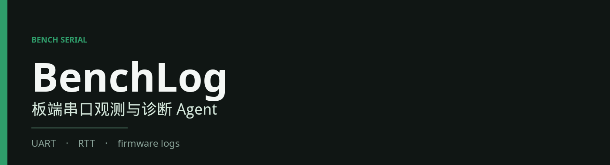

<p align="center">
  
</p>

# BenchLog

**板端串口观测与诊断 Agent.** Watch a board UART or an RTT channel and diagnose firmware logs. Install this package and run `benchlog`.

BenchLog is not a CozeBasedCLI continuation. Banned patterns: XML toolcall, fake SQLite audit, non-resumable sessions, Coze lock-in.

How the package is built, what a default install leaves out, and the upstream lineage are in [BENCHLOG.md](./BENCHLOG.md). [`LICENSE`](./LICENSE) and [`THIRD-PARTY-NOTICES.txt`](./THIRD-PARTY-NOTICES.txt) stay.

## Install

Requires [Bun](https://bun.sh) `>= 1.3.14`. The harness entry is TypeScript.

From a clone of this repository (`bun install` here does **not** install the mirrored `packages/*` workspace):

```sh
bun install
bun run benchlog
```

From the registry:

```sh
bun install -g benchlog
# or
npm install -g benchlog
benchlog
```

`bun add benchlog` and `npm install benchlog` install the same package into a project. `benchlog --version` prints the BenchLog version, then the underlying harness version.

`benchlog --fixture` sets `BENCHLOG_SERIAL_FIXTURE=1` before the session starts, so `serial_open` with no port uses `fixtures/firmware-boot.txt`. That flag stays on the BenchLog CLI and is not forwarded to the harness.

### What you do not install

A global install of `@oh-my-pi/pi-coding-agent` is the harness by itself. It does not apply BenchLog's serial-tool wrapper, and by default it pulls optional Hugging Face / sherpa stacks this product does not use. Installing the mirrored workspace (`package.omp-workspace.json`) pulls local embeddings, speech, browser UI, and the rest of the monorepo and lands around 1–2GB.

BenchLog depends on published `@oh-my-pi/pi-coding-agent@18.10.1` only. Root `overrides` replace `@huggingface/transformers`, `sherpa-onnx*`, `onnxruntime-*`, `fastembed`, and the stats-dashboard packages `lucide-react` / `react` / `react-dom` with an empty stub so a clone install does not download them. `postinstall` deletes those real trees if a parent `npm install` ignored the overrides (npm applies `overrides` only at the project root). It will not remove a package the top-level project, or an unrelated installed package, already depends on. `@oh-my-pi/pi-natives` stays: the host platform leaf is required, and the linux x64 leaf ships both baseline and modern builds because the loader picks one at runtime. `puppeteer-core` and `axe-core` stay because the published harness lists them as dependencies; serial diagnosis does not use the browser tool. OpenTelemetry exporter packages stay; they are small next to the native leaf.

Target: `node_modules` ≤ 500 MiB on linux x64 after a clean product install.

```sh
bun scripts/check-install-size.ts
```

The script measures the machine it runs on. Other OS/CPU combinations install a different `pi-natives` leaf, so the byte count changes. `--self` measures the current checkout instead of a temp install.

### Models and NVIDIA NIM

Providers come from the harness catalog. For NVIDIA NIM, set `NVIDIA_API_KEY` (an NGC personal key). The `nvidia` provider uses `https://integrate.api.nvidia.com/v1`. Other keys are listed in [docs/providers.md](./docs/providers.md).

### Serial tools

`benchlog` loads `.omp/tools/serial` (`serial_list`, `serial_open`, `serial_read`, `serial_write`, `serial_probe`).

- If the working directory contains `.omp/tools/serial/index.ts`, that copy is used. A clone of this repo does.
- Otherwise the CLI passes `--extension` at the installed `benchlog-ext/` directory, which re-exports the same module. Fixture files stay beside that module.

Host UART needs Python 3 and pyserial (`python3 -m pip install -r .omp/tools/serial/requirements.txt`). Hardware RTT needs OpenOCD and an ST-LINK. A ST-LINK with no virtual COM port is not a UART.

Fixture demo, no board and no model:

```sh
bun scripts/benchlog-serial-demo.ts --fixture
bun scripts/benchlog-serial-demo.ts --rtt
```

`serial_list` and `serial_read` are read-tier. `serial_open` is read-tier for a fixture or host UART, and exec-tier for `rtt://`. `serial_write` is exec-tier. `serial_probe` is read-tier for either fixture and exec-tier for a host UART or `rtt://`.

Tool behavior and the RTT command sequence are in [BENCHLOG.md](./BENCHLOG.md) and [.omp/tools/serial/README.md](./.omp/tools/serial/README.md).

## License

MIT. See [LICENSE](./LICENSE) and [THIRD-PARTY-NOTICES.txt](./THIRD-PARTY-NOTICES.txt).
